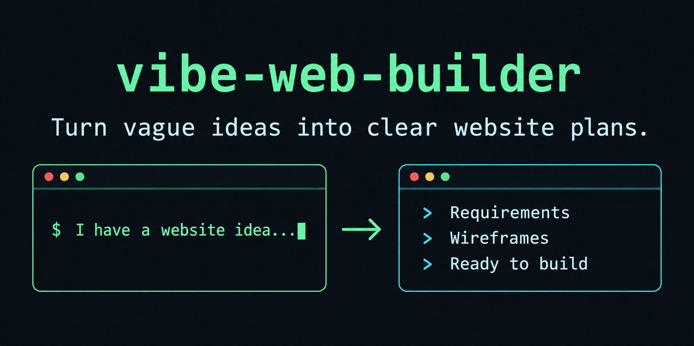
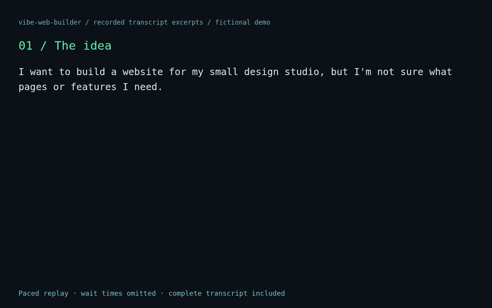
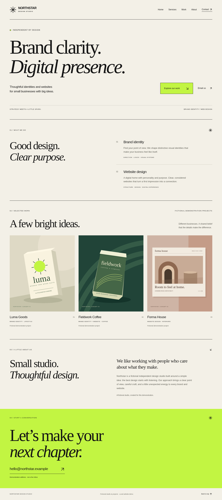
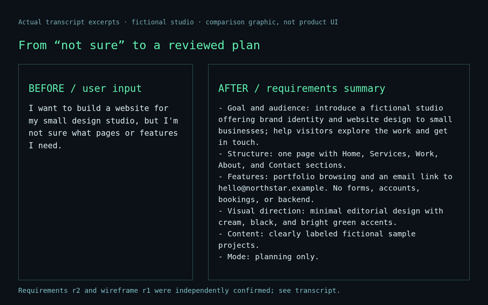

<div align="center">

# vibe-web-builder

### Turn vague ideas into clear website plans.

A beginner-friendly Codex Skill for AI-guided requirements, page sketches, and optional implementation. Describe the outcome. Review the plan. Build when you're ready.

[English](README.md) · [简体中文](README.zh-CN.md)

[](https://github.com/Aloysia0729/vibe-web-builder/actions/workflows/validate.yml) · [v0.1.1 tag](https://github.com/Aloysia0729/vibe-web-builder/tree/v0.1.1) · [No-Charge License](LICENSE)

[Quick Start](#quick-start) · [See It in Action](#see-it-in-action) · [Documentation](#documentation)

</div>



## See It in Action

**A fictional studio. A real Skill run.** Northstar Design Studio starts with “I want a website, but I'm not sure what pages or features I need.” Follow the questions, two separate confirmations, and actual local output below.



Animation: edited transcript replay, **not a live Codex screen recording**. [Read the complete conversation](assets/demo/recorded-run/transcript.md).

<details>
<summary>Static results and the before / after comparison</summary>



[Mobile screenshot](assets/demo/studio-mobile.png) · [Browser checks](assets/demo/recorded-run/verification/browser-results.json)



</details>

This is a simulated user scenario, not a customer endorsement. The [demo record](assets/demo/README.md) distinguishes actual inputs, responses, screenshots, and edited playback. No public deployment is implied.

## Why vibe-web-builder?

| Adaptive Questioning | Two Confirmation Checkpoints | AI-Guided Tech Choices |
|---|---|---|
| Ask only what is missing: up to 1–3 new questions per round, without repeating known answers. | Review requirements **and then** the page sketch. Each has its own confirmation. | Recommend a simple, maintainable approach and reuse an existing project's stack when appropriate. |
| Spend less time explaining yourself. | Catch misunderstandings before implementation. | Decide what your site should do, without guessing which framework to choose. |

Ordinary code-first prompting can leave scope and layout implicit. This Skill adds an explicit planning workflow and saved specifications; it does not promise better results from every model or environment.

## How It Works

```text
Idea → Adaptive Questions → Requirements Review → Wireframe Review → Plan or Build
                                confirm              confirm
```

| Mode | What you receive | Where it stops |
|---|---|---|
| Planning | Requirements, page/interaction specifications, a reviewed wireframe, and a task plan. | No application scaffolding or implementation. Ask explicitly to switch to development. |
| Development | The same two reviews, followed by phased MVP implementation, available checks, and delivery guidance. | External deployment, paid services, secrets, and remote writes require separate authorization. |

The Skill defaults to Simplified Chinese and follows your language. You can change modes without restarting a valid interview.

## Quick Start

### 1. Install

In a Codex environment that provides **`$skill-installer`**, enter:

```text
$skill-installer install https://github.com/Aloysia0729/vibe-web-builder/tree/main/skills/vibe-web-builder
```

No installer? Use the [manual method below](#installation-details). You need access to Codex; the Skill adds no dedicated API key, account, MCP server, or database requirement.

### 2. Describe your idea

```text
$vibe-web-builder I want to plan a website for my small studio, but I don't know where to start.
```

You do not need to know HTML, React, databases, or deployment platforms. Explicit invocation requires installation and host support; automatic matching depends on Codex discovery and configuration.

### 3. Review the plan

As the conversation reaches each stage, six Markdown documents are created and maintained in your **target website project**, under `docs/web-builder/`:

| Document | What becomes clear |
|---|---|
| requirements.md | Goals, audience, scope, assumptions, unresolved questions, and confirmation. |
| sitemap.md | Pages, navigation, modules, and MVP priorities. |
| interactions.md | Buttons, forms, validation, applicable states, and acceptance steps. |
| design.md | Visual direction, page sketches, feedback, and independent confirmation. |
| implementation-plan.md | Technical rationale, tasks, dependencies, and observable acceptance criteria. |
| progress.md | Mode, stage, completed work, check results, limitations, and next action. |

Documents grow with your requirements and confirmation stage. An initialized template is not a finished plan.

## Ideas You Can Start With

| Your goal | A useful starting request |
|---|---|
| Portfolio | “Help potential clients see my work. Plan it first; no login.” |
| Small business | “Show our services and let visitors email us.” |
| Online tool | “Help me define the inputs, results, and error states.” |
| Existing website | “Inspect this project and plan a new work page using its current stack.” |

## More Features

- **Markdown project memory:** decisions and confirmation versions live in files, not hidden chat memory.
- **Resume or revise:** say “pause and save progress” or “continue this project.” Business changes invalidate affected confirmations; a layout-only change requires a new sketch review.
- **Phased MVP:** implement core pages and interactions first, then extend and validate in manageable steps.
- **Testing and delivery:** run applicable checks with available tools, attempt bounded fixes, and distinguish passed, failed, unrun, and code-reading-only conclusions.
- **Capability-aware sketches:** use viewable sketches when supported, otherwise clearly labeled text wireframes or Mermaid. Inaccessible references are never treated as observed.

## Installation Details

The standalone Skill is [skills/vibe-web-builder](skills/vibe-web-builder/). Copy the **whole folder**; its core conversation workflow needs no Python. Run this from your target website project, adjusting the source path:

```bash
VWB_SOURCE=/absolute/path/to/vibe-web-builder
mkdir -p .agents/skills
if [ -e .agents/skills/vibe-web-builder ] || [ -L .agents/skills/vibe-web-builder ]; then
  echo 'Already installed: inspect and back up the existing version first.'
else
  cp -R "$VWB_SOURCE/skills/vibe-web-builder" .agents/skills/vibe-web-builder
fi
```

Reopen Codex as your host requires. Project-scoped discovery and user paths such as `~/.agents/skills/` depend on the installed version; consult [Codex Skills](https://developers.openai.com/codex/skills). Never overwrite an existing installation blindly. Host discovery and marketplace compatibility are not fully verified here.

The optional Python helper needs Python 3.10+ and PyYAML 6.x:

```bash
python3 /path/to/skill/scripts/project.py init --project /path/to/website
python3 /path/to/skill/scripts/project.py check --project /path/to/website
```

Add `--mode development` to init only when the user has selected it. Init refuses existing state. Check validates metadata/version consistency, not genuine user consent, semantic completeness, or a working application. Without the tool, maintain the same templates manually.

A [.codex-plugin/plugin.json](.codex-plugin/plugin.json) is provided for Codex skill-only packaging. No marketplace is configured. A universal root plugin.json format is not claimed; see [format evidence](docs/spec-sources.md) and the [official plugin guide](https://developers.openai.com/codex/plugins/build).

## Documentation

- [Skill instructions](skills/vibe-web-builder/SKILL.md) · [Detailed usage and recovery](docs/presentation/usage.md)
- [Studio demo and evidence](assets/demo/README.md) · [15 behavior scenarios](docs/behavior-scenarios.md)
- [Historical validation report](docs/validation-report.md) · [Current presentation checks](docs/presentation/report.md) · [Acceptance criteria](docs/acceptance.md)
- [Contributing](CONTRIBUTING.md) · [Changelog](CHANGELOG.md) · [Release process](docs/releasing.md) · [License](LICENSE)

To run the existing local checks:

```bash
python3 -m venv .venv
.venv/bin/python -m pip install -r requirements-dev.txt
.venv/bin/python scripts/validate.py
.venv/bin/python -m unittest discover -s tests -v
```

Counts in historical reports apply to those runs, not every platform. Current checks and unverified capabilities are recorded separately.

## Support and Contribute

If this workflow helps you plan websites more confidently, consider starring the repository. [Report an issue](https://github.com/Aloysia0729/vibe-web-builder/issues), share a reproducible example without secrets, or follow the [contribution guide](CONTRIBUTING.md). No star is required to use the Skill.

## License and Limitations

**Source-available under the [Vibe Web Builder No-Charge License 1.0](LICENSE); not MIT or an OSI-approved open-source license.** Free use, modification, and distribution are permitted under its conditions, including free business use. Selling, paid access/hosting, or bundling the Skill or modifications into a paid offering is prohibited without separate permission. Preserve the full notice; modified versions remain subject to the restrictions.

Original websites and code generated with the Skill do not automatically inherit these restrictions and may be commercialized, provided they do not redistribute the Skill or substantial parts of it as a paid offering. The English LICENSE governs the exact terms.

Requirements or sketch approval does **not** authorize external login, secret use, paid services, cloud resources, production changes, deployment, pushes, or important data deletion. Such actions require specific authorization; existing explicit authorization is respected. Never commit real secrets. Tool limitations and unrun checks must be disclosed. This remains an early workflow with partially verified host compatibility, not a guarantee of production readiness.
