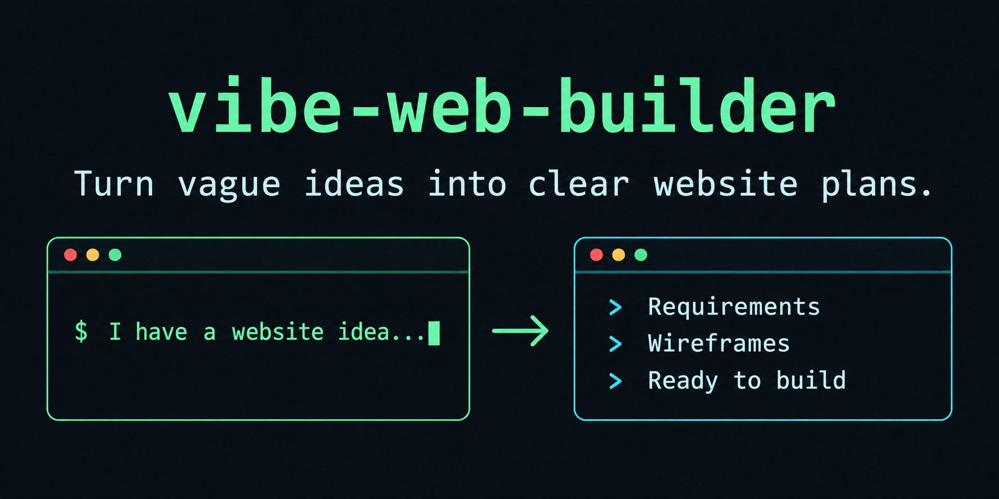
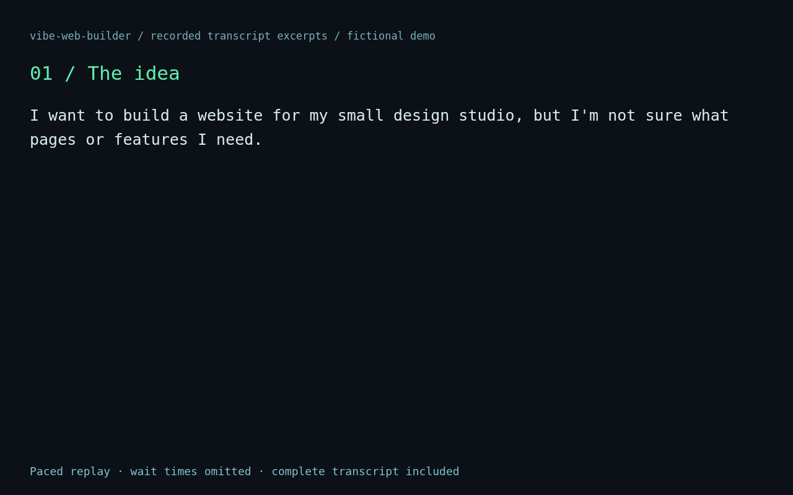
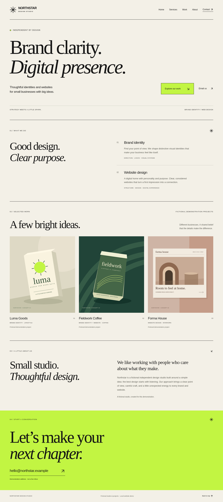
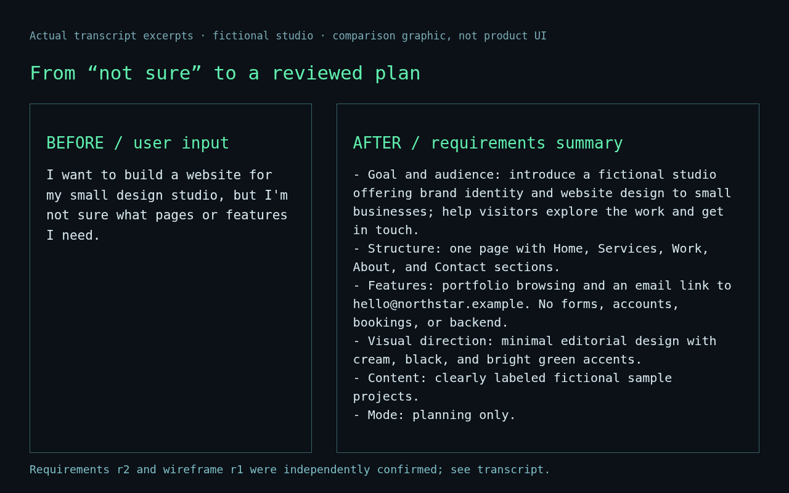

<div align="center">

# vibe-web-builder

### 把模糊想法，变成清晰的建站方案。

面向新手的 Codex Skill：通过 AI 引导梳理需求、确认页面草图；先把想法说清楚，再决定是否开发。不需要提前了解网页架构。

[English](README.md) · [简体中文](README.zh-CN.md)

[](https://github.com/Aloysia0729/vibe-web-builder/actions/workflows/validate.yml) · [v0.1.1 标签](https://github.com/Aloysia0729/vibe-web-builder/tree/v0.1.1) · [禁止收费许可](LICENSE)

[快速上手](#快速上手) · [看看实际过程](#看看实际过程) · [文档导航](#文档导航)

</div>



## 看看实际过程

**虚构工作室，真实 Skill 执行。** Northstar Design Studio 从“想做网站，却不知道需要哪些页面和功能”开始，经过提问、两次独立确认，形成方案并实际运行本地网页。



动画为经过剪辑的真实对话回放，**不是 Codex 实时录屏**。[完整对话](assets/demo/recorded-run/transcript.md)。

<details>
<summary>查看静态成果与 Before / After 对比</summary>



[手机端截图](assets/demo/studio-mobile.png) · [浏览器检查记录](assets/demo/recorded-run/verification/browser-results.json)



</details>

这是模拟用户场景，不是真实客户背书。[演示记录](assets/demo/README.md)区分实际输入、输出、截图和剪辑回放；本地运行不表示已经公开部署。

## 为什么选择 vibe-web-builder？

| 自适应提问 | 两个独立确认节点 | AI 引导技术选型 |
|---|---|---|
| 每轮最多 1–3 个新问题，只问缺失信息，不重复已明确的答案。 | 先确认需求，再独立确认页面草图。 | 推荐简单、易维护的方案，合理时沿用已有项目架构。 |
| 减少重复解释。 | 在编码前发现理解偏差。 | 你决定网站做什么，无需盲选框架。 |

直接要求 AI 写代码时，范围和布局可能没有说清楚。这个 Skill 增加明确的规划流程和持久化规格；不保证所有模型或环境都有更好效果。

## 如何工作

```text
想法 → 自适应提问 → 需求审阅 → 页面草图审阅 → 只交付方案 / 继续开发
                      独立确认       独立确认
```

| 模式 | 交付内容 | 停止位置 |
|---|---|---|
| 规划模式 | 需求、页面/交互规格、确认后的草图、开发任务。 | 不初始化或实现正式应用；明确切换开发模式后才继续。 |
| 开发模式 | 经过同样两次确认，再逐步实现 MVP、检查和交付。 | 部署、付费、密钥和远端写入需要另外授权。 |

默认使用简体中文，跟随用户语言切换。切换模式时保留有效访谈与确认，不必重新开始。

## 快速上手

### 1. 安装

在已提供 **`$skill-installer`** 的 Codex 环境中输入：

```text
$skill-installer install https://github.com/Aloysia0729/vibe-web-builder/tree/main/skills/vibe-web-builder
```

没有安装器时使用下方[手动安装](#安装详情)。你需要具备 Codex 使用条件；Skill 自身不增加专用 API Key、账号、MCP 服务器或数据库要求。

### 2. 描述想法

```text
$vibe-web-builder 我想为自己的小工作室规划一个网站，但不知道从哪里开始。
```

不用先学 HTML、React、数据库或部署平台。显式调用依赖实际安装及宿主支持；自动匹配取决于 Codex 的发现机制与配置。

### 3. 审阅方案

随着对话推进，向导在**目标网站项目**的 `docs/web-builder/` 下维护六份文档：

| 文件 | 帮你明确什么 |
|---|---|
| requirements.md | 目标、用户、范围、假设、未解决问题和需求确认。 |
| sitemap.md | 页面、导航、模块和 MVP 优先级。 |
| interactions.md | 按钮、表单、校验、适用状态及验收步骤。 |
| design.md | 视觉方向、页面草图、反馈和独立确认。 |
| implementation-plan.md | 技术理由、任务、依赖与可观察的验收条件。 |
| progress.md | 模式、阶段、完成事项、测试、限制和下一步。 |

文档内容随需求与确认阶段逐步完善。初始化模板不等于完整方案已交付。

## 可以从这些场景开始

| 想做什么 | 可以这样描述 |
|---|---|
| 个人作品集 | “让潜在客户看到作品，先规划，不需要登录。” |
| 小型企业官网 | “展示我们的服务，让访客用邮箱联系。” |
| 在线工具 | “帮我定义输入、输出和错误处理。” |
| 扩展已有网站 | “检查现有项目，沿用技术栈，规划一个作品页。” |

## 更多能力

- **Markdown 项目记忆**：决定与确认版本保存在文件里，不依赖隐藏会话记忆。
- **暂停、恢复与修改**：说“暂停并保存进度”或“继续这个项目”。业务变化使相关确认失效；只改布局时重新确认草图。
- **MVP 分阶段实施**：先完成核心页面与操作，再逐步扩展和检查。
- **验证与交付指导**：按可用工具运行适用检查、有限修复，区分通过、失败、未运行和代码阅读推断。
- **按能力生成草图**：支持时使用可查看草图，否则用文本线框或 Mermaid；无法读取的参考不会被当作已经观察。

## 安装详情

独立 Skill 位于 [skills/vibe-web-builder](skills/vibe-web-builder/)。复制**整个目录**；核心对话不依赖 Python。在目标网站项目根目录执行，先改为实际源路径：

```bash
VWB_SOURCE=/absolute/path/to/vibe-web-builder
mkdir -p .agents/skills
if [ -e .agents/skills/vibe-web-builder ] || [ -L .agents/skills/vibe-web-builder ]; then
  echo 'Already installed: inspect and back up the existing version first.'
else
  cp -R "$VWB_SOURCE/skills/vibe-web-builder" .agents/skills/vibe-web-builder
fi
```

按宿主要求重开 Codex。项目发现路径及 `~/.agents/skills/` 等用户级路径以当前 [Codex Skills 文档](https://developers.openai.com/codex/skills)为准，不盲目覆盖已安装版本。本环境尚未完整验证宿主自动发现与插件市场兼容性。

可选工具要求 Python 3.10+ 和 PyYAML 6.x：

```bash
python3 /path/to/skill/scripts/project.py init --project /path/to/website
python3 /path/to/skill/scripts/project.py check --project /path/to/website
```

只有用户已选开发模式才在 init 添加 `--mode development`。初始化拒绝覆盖已有状态；check 只核对元数据与版本，不证明用户真实确认、语义完整或应用可运行。没有工具时按同一模板手动维护。

附 [.codex-plugin/plugin.json](.codex-plugin/plugin.json) 用于 Codex skill-only 包装。没有配置 marketplace，不宣称兼容通用根 plugin.json；见[格式依据](docs/spec-sources.md)和[官方插件指南](https://developers.openai.com/codex/plugins/build)。

## 文档导航

- [Skill 主文件](skills/vibe-web-builder/SKILL.md) · [详细使用与恢复](docs/presentation/usage.md) · [原中文内容存档](docs/presentation/previous-guide.zh-CN.md)
- [工作室演示与证据](assets/demo/README.md) · [15 类行为测试](docs/behavior-scenarios.md)
- [历史验证报告](docs/validation-report.md) · [本次展示验证](docs/presentation/report.md) · [验收标准](docs/acceptance.md)
- [贡献指南](CONTRIBUTING.md) · [更新记录](CHANGELOG.md) · [发布流程](docs/releasing.md) · [许可证](LICENSE)

现有本地校验命令：

```bash
python3 -m venv .venv
.venv/bin/python -m pip install -r requirements-dev.txt
.venv/bin/python scripts/validate.py
.venv/bin/python -m unittest discover -s tests -v
```

历史报告中的测试数量只对应当次执行，不代表所有平台。当前复测与未验证能力另行记录。

## 支持与贡献

如果这个流程帮助你更有把握地规划网站，可以给仓库点一个 Star。也欢迎[报告问题](https://github.com/Aloysia0729/vibe-web-builder/issues)、分享不含秘密的复现步骤，或按[贡献指南](CONTRIBUTING.md)参与。使用功能不需要先点 Star。

## 许可与限制

**采用 [Vibe Web Builder No-Charge License 1.0](LICENSE)，是源码可用项目，不是 MIT，也不是 OSI 定义的开源许可。** 在条款范围内可免费使用、修改和分发，包括免费商业使用。未经另外许可，禁止销售、收费访问/托管，或将 Skill、修改版捆绑在付费产品中；保留完整声明，修改版遵守相同限制。

生成的原创网站和代码不自动继承这项限制，可以商业化，但不能借生成产物之名将 Skill 或其主要部分作为收费产品分发。具体权利义务以英文 LICENSE 为准。

需求或草图确认**不授权**外部登录、密钥使用、付费服务、云资源、生产修改、部署、推送或重要数据删除；这些动作需要明确授权，已有明确授权不重复索取。真实密钥不进入仓库。工具限制及未运行检查必须如实披露。这是宿主兼容性部分验证的早期工作流程，不保证生产就绪。
